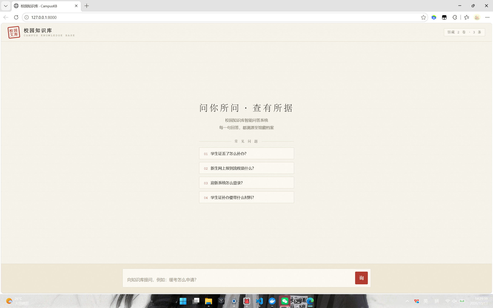

# 校园知识库智能问答系统（CampusKB）

基于 RAG（检索增强生成）的校园知识库问答系统：上传选课手册、教务通知、新生指南等文档，学生用自然语言提问，系统检索相关片段并流式生成带引用的回答。

## 功能

- 文档上传与解析（PDF / Word / Markdown）
- 文档分块 → Embedding → 向量入库（pgvector HNSW）
- 混合检索：BM25 关键词 + 向量语义，RRF 融合
- 流式问答（SSE）+ 引用溯源 + 低置信度拒答
- 对话历史持久化（MySQL）
- 上传接口管理员鉴权（防知识库投毒）
- 评测体系：20 条评测集，拒答阈值调优后边界判断准确率 100%
- Docker Compose 一键部署

## 技术栈

| 层 | 技术 |
| --- | --- |
| 后端 | Python / FastAPI |
| 大模型 | DeepSeek API（流式生成） |
| Embedding | 硅基流动 BAAI/bge-m3 |
| 向量库 | PostgreSQL + pgvector（HNSW 索引） |
| 数据库 | MySQL |
| 部署 | Docker / Docker Compose |

## 界面



## 架构

```text
前端页面（问答 + 文档上传）
        │
   FastAPI 单体应用
   ├─ 入库管线：解析 → 结构感知分块 → Embedding → pgvector + BM25 双索引
   ├─ 问答管线：混合检索 → RRF 融合 → DeepSeek 生成（SSE 流式）→ 引用 + 拒答
   └─ 历史记录：MySQL 存储对话
```

## 快速开始

```bash
# 1. 配置密钥
cp .env.example .env        # 填入 DEEPSEEK_API_KEY 等

# 2. 启动依赖（PostgreSQL/pgvector + MySQL）
docker compose up -d

# 3. 启动后端
pip install -r requirements.txt
uvicorn app.main:app --reload
```
